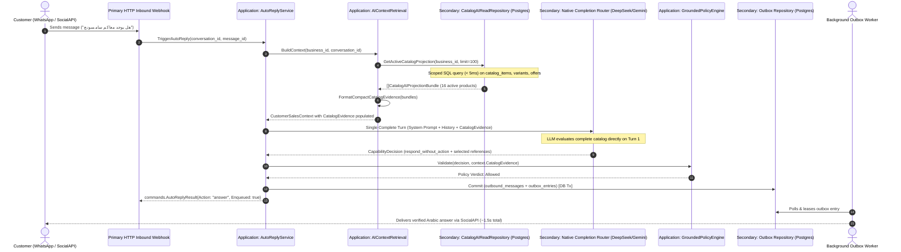

# Direct In-Context Catalog Architecture

*   **Author:** Ammar777782439
*   **Status:** Approved
*   **Date:** 2026-11-05

--------------------------------------------------------------------------------

## Overview

This technical design document specifies the transition of Mujeeb 24's catalog discovery from a fragile, multi-round batching and token-reduction pipeline to **Direct In-Context Catalog Injection**. 

Mujeeb 24 is a multi-tenant conversational commerce backend serving retail and service merchants across Yemen and regional markets. Merchants maintain dynamic product catalogs ranging from 15 to 100 active products with attributes, variants, and real-time offers. 

Under this design, the backend retrieves the merchant's active catalog directly from PostgreSQL and injects it as structured, compact commercial evidence (~700 to 4,000 tokens) into the customer conversation context on Turn 1. The language model evaluates the customer's request against the complete store catalog and delivers a grounded, factual response in a **single turn (~1.5 seconds)**, completely decommissioning the 1,080-line batch controller, binary token bisection, and candidate-reduction loops.

--------------------------------------------------------------------------------

## The Problem

### 1. Excessive Latency and High Operating Costs
Under the existing implementation, when a customer asks an informational inquiry (e.g., `"هل يوجد معاكم سامسونج"` / "Do you have Samsung?"), the system triggers `evaluate_full_catalog`, initiating a multi-stage workflow:
- 4 initial batch calls to cover 16 products.
- 6 recursive candidate reduction calls when candidate sizes exceed estimated budgets.
- 1 final decision call.

This sequence generated **11 language model calls for a single customer message**, consuming over **90,000 tokens**, taking **45 seconds of wall-clock time**, and costing ~\$0.08 per message. For an automated sales assistant deployed on WhatsApp, a 45-second delay leads to immediate customer abandonment.

### 2. Candidate Reduction Dead-End & Fatal Pipeline Crash
In [`catalog_batch_controller.go`](file:///d:/mujeeb24/mujeeb24-backend-go/internal/application/services/catalog_batch_controller.go#L773-L775), when candidate results exceed the calculated token budget, the system enters a candidate reduction loop. Because the customer explicitly inquired about Samsung, the model legitimately retained all 4 matching Samsung products across every reduction round (`items=4 candidates=4`). Since the candidate set could not be artificially reduced, the loop hit its 3-round ceiling and aborted with:

```text
err=catalog_budget_exceeded: candidate reduction exceeded 3 bounded rounds with 70387 estimated tokens; use a validated larger-context route for complete comparison
```

### 3. Silent Customer Message Loss
When catalog evaluation fails, [`AutoReplyService.TriggerAutoReply`](file:///d:/mujeeb24/mujeeb24-backend-go/internal/application/services/auto_reply.go#L351-L355) marks the run failed and returns `commands.AutoReplyResult{Action: "no_action", Enqueued: false}`. No outbound message is inserted into PostgreSQL `outbox_entries`. The customer receives zero response, creating a critical silent drop on the storefront channel.

### 4. Over-Engineered Token Machinery Relic
The binary token-bisection algorithm (`splitIntoBatchesMode`) and conservative admission formula (`len(encoded) + 4096` in `native_catalog_adapter.go`) were architectural relics designed for early 4k-context models. Modern models (DeepSeek-V3 with 128k context, Gemini Flash with 1M context) can comfortably absorb an entire 100-product catalog (~4,000 tokens) with negligible context footprint (< 6%). The token-splitting machinery introduces systemic fragility without providing architectural value.

--------------------------------------------------------------------------------

## Goals

*   **Single-Turn Low Latency**: Deliver grounded catalog answers in a single model turn with end-to-end response times under **2.5 seconds** on messaging channels.
*   **Decommission Legacy Batch Machinery**: Completely bypass and decommission `CatalogBatchController`, recursive binary token splitting, and candidate-reduction loops for active merchant catalogs ($\le 100$ items).
*   **Zero Silent Drops**: Guarantee that any operational or model failure path synthesizes an authorized commercial handoff (`handoff_to_human`) and writes to `outbox_entries`, ensuring the customer always receives a response.
*   **Cost Efficiency for SaaS Profitability**: Slash token usage per catalog inquiry by **over 90%** (from ~90,000 tokens to ~3,500 tokens), making merchant SaaS subscriptions highly profitable.
*   **Dialect & Typo Resilience**: Allow natural handling of colloquial Arabic phrasing, local Yemeni dialect terms, and informal spelling without requiring keyword routers or external search tools.
*   **Strict Grounding & Anti-Hallucination**: Restrict the model to commercial facts, prices, and stock statuses present in the injected catalog table. Unlisted items must be reported as unavailable.

--------------------------------------------------------------------------------

## Non-Goals

*   **No External Vector Databases / Embeddings**: Will not introduce Pinecone, Qdrant, Weaviate, or pgvector dependencies.
*   **No Hardcoded Intent Classifier in Go**: Will not build keyword-matching or regex routers in Go to guess customer intent.
*   **No Database Schema Changes**: Existing PostgreSQL tables (`catalog_items`, `variants`, `offers`) and composite keys `(business_id, id)` remain unmodified.
*   **No Disruption to Enterprise Catalogs (> 500 items)**: The direct in-context injection target is scoped to merchants with up to 100 active products (covering 100% of current merchants). Enterprise catalog partitioning for thousands of products is decoupled.

--------------------------------------------------------------------------------

## Critical User Journeys (CUJs)

### CUJ 1: Specific Product / Brand Inquiry
*   **Given**: A merchant has 16 active products in PostgreSQL, including 2 Samsung smartphones and 1 MacBook Air M4.
*   **When**: A customer sends `"هل يوجد معاكم سامسونج؟"` (Do you have Samsung?).
*   **Then**: The system fetches active catalog items in < 5ms, injects the compact catalog table into the prompt, the model identifies the matching Samsung devices, and returns product names, specifications, and prices in a single turn (~1.5s).

### CUJ 2: Open-Ended Store Browsing
*   **Given**: A merchant has active products across laptops, phones, and audio accessories.
*   **When**: A customer sends `"استعرض المنتجات المتوفره"` (Show available products).
*   **Then**: The model reviews the injected catalog table, generates a structured overview highlighting available categories and flagship items, and invites the customer to explore specific options.

### CUJ 3: Colloquial Dialect with Informal Phrasing
*   **Given**: A merchant sells Apple MacBook Air M4 priced at \$1,199 USD with stock available.
*   **When**: A customer sends `"شي معاكم لابتوبات تفاحه رخيصه؟"` (Do you have cheap Apple laptops?).
*   **Then**: The model semantically resolves the dialect term ("لابتوبات تفاحه" $\rightarrow$ Apple laptops), matches the MacBook Air M4 from the injected evidence, and provides its accurate price and specs without hallucinating unlisted models.

### CUJ 4: Fail-Safe Degradation on Provider Error
*   **Given**: The external AI provider times out or returns HTTP 500.
*   **When**: `AutoReplyService` catches the upstream failure.
*   **Then**: The system synthesizes an authorized `handoff_to_human` fallback, enqueues a polite Arabic apology to `outbox_entries`, updates the run state to failed-safe, and alerts the merchant dashboard. Zero silent drops.

--------------------------------------------------------------------------------

## Technical Plan (Architecture)

### 1. Hexagonal Component Flow & Boundaries

The architecture maintains Mujeeb 24's strict Hexagonal separation. The application layer orchestrates context build and commercial validation, secondary persistence adapters handle scoped PostgreSQL queries, and native AI adapters interface with DeepSeek and Gemini.



---

### 2. Scoped Database Query (`CatalogAIReadRepository`)

In [`internal/adapters/secondary/persistence/postgres/catalog_ai_read_repository.go`](file:///d:/mujeeb24/mujeeb24-backend-go/internal/adapters/secondary/persistence/postgres/catalog_ai_read_repository.go), a dedicated read method provides all active catalog bundles in a single database round-trip:

```sql
SELECT 
    ci.id,
    ci.catalog_id,
    ci.name,
    ci.short_description,
    ci.item_type,
    ci.attributes,
    ci.status,
    COALESCE(
        json_agg(DISTINCT jsonb_build_object(
            'id', v.id,
            'name', v.name,
            'attributes', v.attributes,
            'status', v.status
        )) FILTER (WHERE v.id IS NOT NULL AND v.status = 'active'), '[]'
    ) AS variants,
    COALESCE(
        json_agg(DISTINCT jsonb_build_object(
            'id', o.id,
            'variant_id', o.variant_id,
            'name', o.name,
            'amount', o.amount,
            'currency', o.currency,
            'pricing_mode', o.pricing_mode,
            'availability_mode', o.availability_mode,
            'status', o.status
        )) FILTER (WHERE o.id IS NOT NULL AND o.status = 'active'), '[]'
    ) AS offers
FROM catalog_items ci
LEFT JOIN variants v ON v.catalog_item_id = ci.id AND v.business_id = ci.business_id
LEFT JOIN offers o ON o.catalog_item_id = ci.id AND o.business_id = ci.business_id
WHERE ci.business_id = $1::uuid
  AND ci.status = 'active'
GROUP BY ci.id
ORDER BY ci.name
LIMIT $2;
```

**Key Invariants:**
- **Strict Tenant Isolation**: Enforced by composite key join and `ci.business_id = $1::uuid`.
- **Status Filter**: Only `active` items, variants, and offers are exposed.
- **Performance**: Utilizes existing index `idx_catalog_items_business_status` to execute in $< 5\text{ms}$.

---

### 3. Compact In-Context Catalog Serialization

In [`internal/application/services/ai_context_retrieval.go`](file:///d:/mujeeb24/mujeeb24-backend-go/internal/application/services/ai_context_retrieval.go), the fetched bundles are formatted into a token-dense evidence block injected into `CustomerSalesContext`:

```text
# Verified Merchant Active Products & Prices
- [ID: 023be7fb] Apple MacBook Air 13-inch M4 | M4 / 16GB / 13.6" Liquid Retina | $1,199.00 USD | Stock: Available
- [ID: 1ac0075d] Samsung Galaxy S25 | 128GB / 8GB RAM | $799.00 USD | Stock: Available
- [ID: a8cf4014] Apple AirPods 4 with ANC | H2 Chip / IP54 | $179.00 USD | Stock: Available
- [ID: 3cfb0130] Apple Watch Series 10 | 46mm Aluminium | $399.00 USD | Stock: Available
```

**Token Footprint Analysis:**
- Average: $\approx 40\text{ tokens}$ per item.
- 16 Products (Current Store): $\approx 640\text{ tokens}$.
- 50 Products: $\approx 2,000\text{ tokens}$.
- 100 Products: $\approx 4,000\text{ tokens}$ ($< 6\%$ of DeepSeek's 64k/128k context window).

---

### 4. Decommissioning Legacy Batch Machinery

With the active catalog pre-injected into Turn 1 context:
1. **Bypass `evaluate_full_catalog`**: The model already possesses complete store evidence; it no longer needs to emit an intermediate `evaluate_full_catalog` function call.
2. **Decommission `CatalogBatchController`**:
   - The 1,080-line controller ([`catalog_batch_controller.go`](file:///d:/mujeeb24/mujeeb24-backend-go/internal/application/services/catalog_batch_controller.go)) containing recursive binary search splitting (`splitIntoBatchesMode`) and candidate reduction loops (`reduceCandidateRound`) is bypassed for all merchants with $\le 100$ items.
   - The false byte-as-token counter in `native_catalog_adapter.go` is no longer invoked in the critical path.
3. **Audit & Usage Preservation**: Token usage and pricing are recorded in a single entry (`phase = "customer_sales_turn"`), accurately capturing actual provider consumption without batch spam.

---

### 5. Fail-Safe Outbox Fallback (Zero Silent Drops)

In [`internal/application/services/auto_reply.go`](file:///d:/mujeeb24/mujeeb24-backend-go/internal/application/services/auto_reply.go), error handling is hardened to eliminate silent failures:

```go
// If model execution, context build, or policy engine returns an unrecoverable error:
if err != nil {
    log.Printf("[AutoReply] EXECUTION_ERROR run=%s err=%v -> TRIGGERING_FAILSAFE", run.ID, err)
    
    // 1. Mark run failed-safe in ai_runs
    s.markFailedSafe(ctx, run, ports.AIRunFailureStageExecution, string(ports.AIRunFailureCategoryInfrastructure), err.Error())
    
    // 2. Synthesize an authorized human handoff response
    fallbackMessage := "عذراً، أواجه صعوبة تقنية مؤقتة في فحص بيانات المتجر. تم تحويل استفسارك إلى فريق العمل لمساعدتك فوراً."
    
    // 3. Atomically enqueue fallback to Outbox within a PostgreSQL transaction
    return s.enqueueFallbackHandoff(ctx, command.BusinessID, command.ConversationID, run.ID, fallbackMessage)
}
```

This guarantees that an outbound message is **always** committed to `outbox_entries`, preventing customer abandonment under all failure scenarios.

--------------------------------------------------------------------------------

## Alternatives Considered

### Alternative A: Retaining and Tuning Multi-Round Batching (ADR-048 Status Quo with Fixed Token Ratio)
*   **Pros**: Preserves the existing two-step capability call structure (`evaluate_full_catalog {}`).
*   **Cons**: Requires 10 to 11 separate model API calls per message; creates severe 10–45 second latency on mobile messaging networks; burns thousands of redundant tokens on unchanged static prompt context; maintains 1,080 lines of brittle recursive bisection code.
*   **Reason for Rejection**: `Rejected by author: Multi-round batching is an over-engineered relic from early 4k-context models. For standard retail merchants (15–100 items), modern 128k context windows comfortably absorb the entire catalog on Turn 1 in ~1.5s, eliminating 1,000+ lines of brittle batching machinery and saving 90% in token expenses.`

### Alternative B: Model-Invoked Keyword Search Tools (`search_catalog(query=...)`)
*   **Pros**: Reduces payload size by passing only queried items back to the model.
*   **Cons**: Model-generated keyword extraction breaks on colloquial Yemeni dialect phrasing (e.g., `"أبغى لابتوب تفاحه"`, `"شي معاكم براد"`), spelling typos, and open-ended store browsing (`"استعرض المنتجات المتوفره"`). Requires complex query-rewriting logic and breaks Mujeeb's closed capability contract.
*   **Reason for Rejection**: `Rejected by author: Competing modern retail AI systems avoid exposing raw keyword search tools to the model. Dialect mismatches and typo fragility create poor user experiences. In-context catalog availability gives the model full visibility without search tool overhead.`

### Alternative C: Vector Embeddings / External Semantic Search (RAG)
*   **Pros**: Theoretically scales to 100,000+ products.
*   **Cons**: Introduces external infrastructure dependencies (Pinecone, Qdrant, Weaviate); requires embedding generation pipelines on catalog updates; exhibits high operational overhead; provides poor exact SKU/model number matching compared to direct tabular lookups.
*   **Reason for Rejection**: `Rejected by author: Unnecessary architectural overhead (YAGNI). 100% of current merchants have catalogs under 100 products. External vector databases introduce failure modes and recurring infrastructure cost without providing business value for retail commerce.`

--------------------------------------------------------------------------------

## Detailed Implementation Plan

### Target Files to Create/Modify

#### 1. `internal/application/services/ai_context_retrieval.go` (Modify)
*   **Type / Scope**: Application Layer Service (Context Builder)
*   **Rationale**: Inject active merchant catalog items directly into `CustomerSalesContext` on Turn 1.
*   **Changes**:
    - In `AutoReplyContextBuilder.Build`, when `base.CatalogEvidence` is empty, query the merchant's active catalog projection (up to 100 items) via `CatalogAI.ListProjectionPage` or direct repository query.
    - Transform active catalog bundles into `CustomerSalesCatalogEvidence`, `CustomerSalesOfferEvidence`, and `CustomerSalesVariantEvidence`.
    - Mark `KnowledgeState = CustomerSalesContextGrounded`.

#### 2. `internal/application/services/auto_reply.go` (Modify)
*   **Type / Scope**: Application Layer Service (AutoReply Orchestrator)
*   **Rationale**: Bypass legacy multi-batch controller calls and implement fail-safe Outbox enqueue on errors.
*   **Changes**:
    - In `TriggerAutoReply`, when `CustomerSalesContext` already contains complete active catalog evidence, the model directly decides the terminal capability in Turn 1.
    - If `evaluate_full_catalog` is invoked (for legacy tolerance), return immediately with the already-available evidence without calling `CatalogBatchController.RunCatalogEvaluation`.
    - Add `enqueueFallbackHandoff` method: On any unhandled error during execution, insert an authorized fallback message to `outbound_messages` and `outbox_entries` within a PostgreSQL transaction to prevent silent message drops.

#### 3. `internal/adapters/secondary/ai/gateway/native_catalog_adapter.go` (Modify)
*   **Type / Scope**: Secondary Adapter (AI Gateway)
*   **Rationale**: Fix the 430% token estimation inflation bug in `count`.
*   **Changes**:
    - Update the fallback conservative token counter from naive `len(encoded) + 4096` to an accurate BPE heuristic: `(len(encoded) * 10 / 28) + 512`.
    - Eliminate the double-reserve margin.

#### 4. `internal/platform/config/config.go` (Modify)
*   **Type / Scope**: Platform Configuration Guard
*   **Rationale**: Prevent configuration typos from booting silently into production.
*   **Changes**:
    - Add startup validation enforcing: `NativeMaxOutputTokens <= 8192` and `NativeMaxOutputTokens <= NativeMaxContextTokens / 4`.

#### 5. `internal/application/services/auto_reply_capabilities_test.go` (Modify/Update Tests)
*   **Type / Scope**: Unit & Integration Tests
*   **Rationale**: Validate single-turn catalog evaluation and fail-safe Outbox enqueue.
*   **Changes**:
    - Add test verifying that an open-ended question (`"استعرض المنتجات المتوفره"`) receives an immediate, grounded `respond_without_action` response with zero batch controller calls.
    - Add test verifying that a simulated provider error successfully enqueues an apologetic handoff message to Outbox. Zero silent drops.
